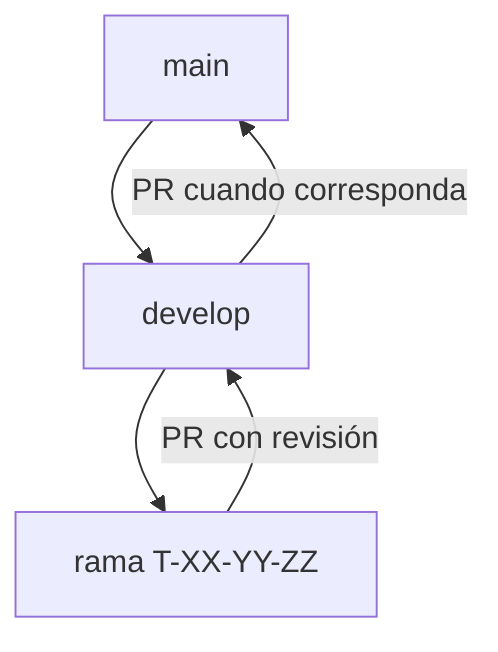

# Desarrollo: Git, OpenSpec, TDD y SDD — Vectra

> **Estado:** Convención del proyecto  
> **Relacionado:** [7. Tickets](7-tickets.md) · [6. Historias (DoD)](6-historias.md) · [OpenSpec `config.yaml`](../openspec/config.yaml)

Este documento es la **fuente canónica** del flujo de trabajo humano. Las reglas del agente en Cursor (`.cursor/rules/`) y la configuración de OpenSpec deben estar alineadas con lo aquí descrito.

---

## 1. Modelo de ramas



| Rama | Propósito |
|------|-----------|
| **`main`** | Línea estable; refleja entregas consolidadas. |
| **`develop`** | Integración continua; **todas** las ramas de trabajo salen de aquí. |
| **`T-XX-YY-ZZ`** | Una **spec OpenSpec** en curso (ver § 2). No usar prefijos `feature/`. |

**Reglas:**

- Crear la rama desde `develop` actualizado: `git checkout develop && git pull && git checkout -b T-02-14-01`.
- Integrar en **`develop`** mediante Pull Request (no merge directo a `main` desde ramas de spec).
- **`main`** se actualiza desde `develop` al cerrar una entrega del curso o un hito, y cada actualización lleva un tag de versión (ver § 10).
- No hay ramas por historia (HU): el seguimiento de cada HU se hace con issues y milestones de GitHub (ver § 11).

Ramas con convención antigua (p. ej. `feature/entrega-1-DPM`) no usan `T-XX-YY-ZZ`. Integrarlas en `develop` vía PR cuando corresponda; **desde entonces** abrir specs y ramas con el formato nuevo.

---

## 2. Tickets, specs e identificadores

| Concepto | ID | Dónde vive |
|----------|-----|------------|
| **Ticket** (backlog) | `T-XX-YY` | [7-tickets.md](7-tickets.md) |
| **Spec de implementación** | `T-XX-YY-ZZ` | OpenSpec change + rama Git |

- Un ticket puede requerir **varias specs** (`ZZ = 01`, `02`, …). Cada spec acota un slice implementable (~2 h, alineado al ticket).
- **`ZZ`** es secuencial por ticket (dos dígitos: `01`, `02`, …).
- **1 change OpenSpec activo = 1 rama Git = 1 spec** (`T-XX-YY-ZZ`).
- El **nombre del change** en OpenSpec coincide con el nombre de la rama.

Cada change debe declarar el **ticket padre** `T-XX-YY` (frontmatter o sección «Ticket padre») y enlazar **Hace** / **Listo cuando** del ticket.

**Ejemplo:** ticket `T-00-02` (verificación de dependencias de `domain`) podría dividirse en:

- `T-00-02-01` — script `check-domain-deps.sh`
- `T-00-02-02` — job de CI que ejecuta el script

---

## 3. SDD + TDD

**SDD (Spec-Driven Development):** la spec OpenSpec se deriva del ticket; define alcance, criterios de aceptación y comportamiento esperado antes de cerrar la implementación.

**TDD (Test-Driven Development):** los tests se escriben en función de la spec; el ciclo es **Red → Green → Refactor**.

| Fase | Qué ocurre |
|------|------------|
| **Spec** | Change OpenSpec `T-XX-YY-ZZ` con escenarios verificables (happy path y **camino no feliz**: errores de dominio, `problem+json`, validación, conflictos, etc.). |
| **Red** | Tests que fallan porque aún no existe la implementación. |
| **Green** | Implementación mínima hasta que la suite acordada pase. |
| **Refactor** | Mejora sin cambiar comportamiento; tests siguen en verde. |

La DoD común de historias ([6.1](6-historias.md)) aplica: conformidad con `openapi.yaml`, trazas, accesibilidad en UI cuando corresponda.

---

## 4. Flujo paso a paso

1. Elegir ticket `T-XX-YY` en [7-tickets.md](7-tickets.md) (dependencias satisfechas).
2. Definir o crear la spec **`T-XX-YY-ZZ`** en OpenSpec (change bajo `openspec/changes/`).
3. Documentar en el change los **tests** previstos (unitarios, integración, API unhappy path según alcance).
4. Crear rama **`T-XX-YY-ZZ`** desde `develop`.
5. TDD: red → green → refactor.
6. Ejecutar la **suite completa** relevante (local; cuando exista CI, los mismos comandos que GitHub Actions — ver ticket T-09-01).
7. `openspec validate` sobre el change (si aplica).
8. **`openspec archive <change-name>`** solo con tests en verde (happy + unhappy). Quien archiva: el maintainer o el agente **solo con autorización explícita**.
9. **Solo después del paso 8:** el agente **debe proponerte** un commit (archivos, mensaje [Conventional Commits](https://www.conventionalcommits.org/en/v1.0.0/) § 7, pregunta de autorización). **No ejecuta** `git commit` hasta que respondas que sí.
10. Con el commit en la rama (o listo para commitear), el agente **debe proponerte** un PR hacia **`develop`** (título, cuerpo, base/head, push si aplica). **No** crea el PR hasta tu OK. El título sigue la misma convención que el subject del commit.

### Regla de commit en ramas `T-XX-YY-ZZ`

En una rama de spec **no hay commits de Git hasta que el change OpenSpec esté archivado**.

| Fase | Git |
|------|-----|
| Change activo + TDD (red / green / refactor) | Cambios en el **working tree** (y staging solo para revisión). **Sin** `git commit`. |
| Tras `openspec archive` | **Primer** commit de la rama (convención: uno por spec archivada). |
| Integración | PR → `develop` con ese commit (o commits acordados **solo post-archive**). |

Esto aplica al **agente de Cursor** siempre. Si pedís commit antes de archivar, debe rechazarlo, recordar esta regla y ofrecer archivar primero (con tests green y tu OK).

Excepciones: ramas que **no** son specs (`develop`, `main`, ramas legacy) o acuerdo explícito documentado fuera de este flujo.

---

## 5. Comandos de verificación (evolutivos)

Hasta que el workspace Rust y la CI (T-09-01) existan, la suite concreta se acuerda por spec en el change. Cuando estén disponibles, la referencia mínima es:

```bash
cargo fmt --all -- --check
cargo clippy --workspace -- -D warnings
cargo test --workspace
```

Tests de API deben incluir respuestas de error alineadas con [5-contract-api.md](5-contract-api.md) y `openapi.yaml`.

OpenSpec:

```bash
openspec validate <change-name>
openspec archive <change-name>
```

---

## 6. OpenSpec en el repositorio

| Ruta | Uso |
|------|-----|
| `openspec/config.yaml` | Contexto del proyecto y reglas al generar artefactos |
| `openspec/changes/<T-XX-YY-ZZ>/` | Change activo |
| `openspec/changes/archive/` | Changes archivados |
| `openspec/specs/` | Specs consolidadas tras archivar |

Tras `openspec archive`, las specs maestras se actualizan en `openspec/specs/` según el schema `spec-driven`.

---

## 7. Mensajes de commit (Conventional Commits)

Seguimos [Conventional Commits 1.0.0](https://www.conventionalcommits.org/en/v1.0.0/) en la medida que aplique al repo.

### Formato

```
<type>(<scope>): <description>

[cuerpo opcional]

[footer opcional]
```

- **Subject:** imperativo, minúsculas en la descripción (salvo nombres propios), sin punto final, ~72 caracteres.
- **Scope (recomendado):** ID de la spec en curso, p. ej. `(T-02-14-01)`. Alternativa: crate o área (`api`, `catalog`) si el commit es transversal dentro de la misma rama.
- **Footer (recomendado):** `Refs: T-02-14, HU-02-04` con el ticket padre y la(s) historia(s) que habilita (columna «HU» de [7-tickets.md](7-tickets.md)). Permite `git log --grep HU-02-04`.

### Tipos habituales en Vectra

| Tipo | Uso |
|------|-----|
| `feat` | Comportamiento nuevo (endpoint, UI, comando CLI, regla de dominio). |
| `fix` | Corrección de bug. |
| `test` | Cambios centrados en tests (suelen ir en el commit de cierre post-archive). |
| `docs` | Solo documentación (`docs/`, OpenSpec archivado, README). |
| `refactor` | Cambio interno sin alterar comportamiento observable. |
| `chore` | Mantenimiento (deps, scripts auxiliares no funcionales). |
| `ci` | Pipelines y checks (p. ej. GitHub Actions). |
| `build` | Toolchain, `Cargo.toml`, empaquetado. |

`BREAKING CHANGE:` o `!` tras el tipo/scope solo si el cambio rompe contrato (`openapi.yaml`) o compatibilidad; en el MVP es raro y debe mencionarse en la spec.

### Ejemplos

```
feat(T-00-02-01): add check-domain-deps script

Refs: T-00-02, HU-00-01
```

```
test(T-03-13-01): cover search 400 invalid query

Refs: T-03-13, HU-03-03, HU-03-04
```

```
docs(T-09-01-01): document CI workflow in readme

Refs: T-09-01, HU-00-01, HU-09-01
```

**Un commit de cierre por spec archivada** en la rama `T-XX-YY-ZZ` (implementación + tests + artefactos OpenSpec archivados). Partir en varios commits **solo post-archive** si el maintainer lo pide explícitamente; mismo **scope** (`T-XX-YY-ZZ`).

---

## 8. Agente Cursor (resumen)

- En ramas **`T-XX-YY-ZZ`**: **ningún** `git commit` hasta **`openspec archive`** completado (TDD sin commits intermedios).
- **Proponer** commit y PR de forma **proactiva** cuando corresponda; **ejecutar** solo con tu autorización explícita a esa propuesta concreta.
- Tras **archive** + tests green: **obligatorio** proponer commit; tras commit en rama lista: **obligatorio** proponer PR → `develop`.
- Al cerrar una entrega o hito: proponer PR `develop → main`, tag y release (§ 10); ejecutar solo con autorización.
- Detalle ejecutable: `.cursor/rules/git-workflow.mdc`, `git-agent-gates.mdc`, `openspec-tdd-delivery.mdc` y [AGENTS.md](../AGENTS.md).

### 8.1. Propuesta de commit (lo que debe mostrarte el agente)

1. Resumen de `git status` (qué se incluiría).
2. Mensaje completo propuesto (subject + body/footer si aplica).
3. Pregunta clara: *¿Autorizás que ejecute este commit?*

### 8.2. Propuesta de PR (lo que debe mostrarte el agente)

1. `base` → `develop`, `head` → rama actual.
2. Título y cuerpo (plantilla § 9).
3. Si falta push al remoto, indicarlo y pedir OK aparte o junto al PR.
4. Pregunta clara: *¿Autorizás que cree el PR (y push si hace falta)?*

---

## 9. Plantilla mínima de Pull Request

Usar al integrar `T-XX-YY-ZZ` → `develop`:

- **Rama:** `T-XX-YY-ZZ`
- **Ticket padre:** `T-XX-YY` (enlace o sección en 7-tickets)
- **Historia(s):** `Part of #N` con el issue de cada HU; `Closes #N` si es el último spec de esa HU (§ 11)
- **Milestone:** el del hito de la HU (`H1`, `H2`, …)
- **Change OpenSpec:** archivado (`openspec archive` completado)
- **Tests:** comandos ejecutados y resultado (green, incl. unhappy path)
- **Título del PR:** Conventional Commits, p. ej. `feat(T-02-14-01): …` (alinear con el commit principal)
- **Notas:** cambios en `openapi.yaml` / modelo si aplica

---

## 10. Releases y tags

Los tags marcan versiones y **solo se crean en `main`**, después de mergear `develop → main`. `develop` y las ramas de spec no llevan tags.

| Momento | Versión | Ejemplo |
|---------|---------|---------|
| Entrega intermedia del curso | `v0.N.0` | `v0.1.0`, `v0.2.0` |
| H1 — Buscador inteligente (MVP del curso) | `v1.0.0` | — |
| H2 — Asistente IA | `v1.1.0` | — |
| H3 — Manos libres | `v1.2.0` | — |
| H4 — Extensiones condicionadas | `v1.3.0` | — |
| Corrección sobre una versión publicada | patch | `v1.0.1` |

- Versionado [SemVer](https://semver.org/lang/es/). Sin release candidates.
- Tags **anotados** (`git tag -a`), nunca ligeros.
- Cada tag tiene un GitHub Release con notas generadas desde los PRs.
- Un hito se cierra cuando todas las HUs de su milestone están cerradas y los e2e de EP-09 pasan en `develop`.

### Procedimiento

1. PR `develop → main` titulado `chore(release): vX.Y.Z` con el hito o la entrega en el cuerpo.
2. Tras el merge:

```bash
git checkout main && git pull
git tag -a vX.Y.Z -m "H1 — Buscador inteligente (MVP del curso)"
git push origin vX.Y.Z
gh release create vX.Y.Z --generate-notes
```

El PR, el tag, el push del tag y el release requieren autorización explícita (igual que commits y PRs, § 8).

---

## 11. Seguimiento de historias (HU)

Las HUs no tienen rama ni tag. Su estado vive en GitHub:

| Elemento | Convención |
|----------|------------|
| **Milestone** | Uno por hito: `H1 — Buscador inteligente`, `H2 — Asistente IA`, … |
| **Issue** | Uno por HU, título `HU-XX-YY <título>` (de [6-historias.md](6-historias.md) § 6.3.1), en el milestone de su hito. Cuerpo: checklist de tickets `T-XX-YY` según [7-tickets.md](7-tickets.md) § 7.18. |
| **PR de spec** | `Part of #N` por cada HU que habilita; `Closes #N` en el PR que completa la HU. |
| **Commit** | Footer `Refs: T-XX-YY, HU-XX-YY` (§ 7). |

HUs con alcance **MVP parcial**: el issue se cierra en H1 con los escenarios del MVP; lo pendiente se abre como issue nuevo (`HU-XX-YY (v2) <título>`) en el milestone del hito v2 correspondiente.
