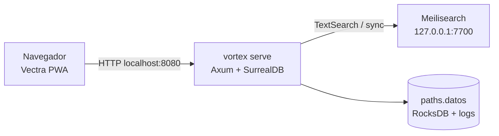

## Índice

0. [Ficha del proyecto](#0-ficha-del-proyecto)
1. [Descripción general del producto](#1-descripción-general-del-producto)
2. [Arquitectura del sistema](#2-arquitectura-del-sistema)
3. [Modelo de datos](#3-modelo-de-datos)
4. [Especificación de la API](#4-especificación-de-la-api)
5. [Historias de usuario](#5-historias-de-usuario)
6. [Tickets de trabajo](#6-tickets-de-trabajo)
7. [Flujo de desarrollo (Git, OpenSpec, TDD)](#7-flujo-de-desarrollo-git-openspec-tdd)
8. [Pull requests](#8-pull-requests)

---

## 0. Ficha del proyecto

### **0.1. Tu nombre completo:**

Diego Pablo Mansilla

### **0.2. Nombre del proyecto:**

Vectra

### **0.3. Descripción breve del proyecto:**

**Vectra** es un buscador inteligente de mostrador *Local-First* para ferreterías y repuestos automotrices. Desde una PWA en la red local, el vendedor localiza productos al instante por texto, voz o lenguaje natural (Modo IA) y recibe sustitutos, similares y complementarios según el stock, sin depender de internet. El backend **Vortex Core** (Rust) corre en un Mac en el local y concentra catálogo, búsqueda y modelos de IA en el **Nodo Maestro**.

### **0.4. URL del proyecto:**

https://github.com/diegopablomansilla/AI4Devs-finalproject

No hay URL de deploy en la nube. Para probarla en local (Mac Apple Silicon): [§ 1.4](#14-instrucciones-de-instalación).

---

## 1. Descripción general del producto


### **1.1. Objetivo:**

Dar al mostrador de ferreterías y repuestos una forma rápida y fiable de encontrar cualquier SKU —aunque el nombre sea impreciso o haya errores de tipeo— y de actuar cuando no hay stock, **sin depender de internet ni de la nube**.

**Qué soluciona:** catálogos enormes y técnicos, búsquedas del POS que fallan con un typo, ventas perdidas por desconocer sustitutos y pocas ventas cruzadas, además del costo y la fragilidad de soluciones con IA en la nube.

**Para quién:** el **vendedor** gana un asistente en el mostrador (texto, voz, preguntas en lenguaje natural y recomendaciones); el **dueño** reduce ventas perdidas y sube el ticket sin pagar servicios externos; el **encargado** mantiene catálogo, stock y relaciones entre productos en el mismo sistema.

### **1.2. Características y funcionalidades principales:**

- **Omnibox multimodal:** barra de búsqueda central en la PWA; modos texto, voz, Modo IA y (en alcance extendido) cámara, con foco permanente para uso en mostrador.
- **Búsqueda por texto:** resultados mientras se escribe, tolerancia a typos, ranking por relevancia y stock, resaltado de coincidencias, sugerencias, sinónimos del rubro, búsqueda por SKU/código fabricante/OEM y filtros (categoría, marca, atributos, stock).
- **Recomendaciones por grafo:** al elegir un producto, panel con similares, sustitutos (destacados si no hay stock) y complementos, definidos y curados por el administrador.
- **Modo IA (RAG local):** preguntas en lenguaje natural con respuesta en streaming; solo cita productos reales del catálogo con stock, sin inventar SKUs.
- **Búsqueda por voz:** transcripción local (Whisper), normalización de medidas y jerga, ruteo a búsqueda, IA, stock o cámara; transcripción editable en el Omnibox.
- **Catálogo e inventario nativos:** ABM de productos, categorías, marcas y atributos técnicos; stock mediante ledger inmutable (ingresos, ajustes, ventas); imágenes, sinónimos y dataset semilla para arranque.
- **Operación local:** varias terminales en la LAN contra un **Nodo Maestro**; micrófono y cámara en el navegador; degradación controlada si falla un motor (p. ej. Meilisearch u Ollama) sin tumbar la búsqueda básica.
- **Extensiones condicionadas del MVP:** búsqueda visual por foto (**Vortex Vision**) y **POS básico** (carrito y confirmación de venta con descuento atómico de stock, sin pagos ni facturación).

**Alcance del MVP del curso** (ver [docs/1, § 1.5](docs/1-descripcion-general-del-producto.md#15-alcance-del-mvp)):

- **Entra:** búsqueda por texto tolerante a errores (con búsqueda por código), recomendaciones por grafo (similares, sustitutos destacados sin stock, complementarios), alta y edición de productos, categorías, marcas, atributos y stock, dataset semilla de ~200 SKUs y una **PWA** con vistas de operador y administración para probar todo desde la GUI. Se ejecuta por HTTP en `localhost`.
- **Pasa a v2:** Modo IA, voz, búsqueda visual, POS, HTTPS con CA local y `vectra.local`, servicio `launchd`, backups, supervisor de sidecars, imágenes de producto, facetas, sugerencias, sinónimos, búsqueda de respaldo, *benchmarks* y pruebas de degradación.
- Detalle por historia en [docs/6, § 6.3.1](docs/6-historias.md#631-alcance-por-historia); ruta de 104 tickets en [docs/7, § 7.5.1](docs/7-tickets.md#751-ruta-del-mvp-del-curso).

### **1.3. Diseño y experiencia de usuario:**

**Idea de interfaz:** Vectra es una PWA de mostrador con **modo oscuro** (`#0A0A0A`) y estética **Glassmorphism** (tarjetas translúcidas, desenfoque de fondo): legible bajo luz de local, con contraste accesible (WCAG AA) y botones grandes (≥ 44 px) para uso táctil con las manos ocupadas. El **Omnibox** ocupa el centro de la pantalla del **Operador** y recupera el foco tras cada acción; a su alrededor van resultados en tarjetas (foto, stock, precio, ubicación) y, al elegir un ítem, un panel lateral con recomendaciones. Iconos discretos activan voz, Modo IA (`?`) y, si está habilitado, cámara. La zona **Administrador** reutiliza el mismo lenguaje visual para ABM de catálogo, stock, relaciones y sinónimos (en el MVP no hay login: solo cambio de vista).

**Ejemplos de uso (Operador):**

1. Un cliente pide “un tornillo así” pero no sabe el nombre: el vendedor escribe *tornilo hexagonal m8* en el Omnibox, corrige el typo gracias a la búsqueda tolerante, abre la ficha y ofrece arandela y tuerca desde **Se usa junto con**.
2. El producto elegido tiene **stock 0**: el panel resalta **Sustitutos** con alternativas disponibles ordenadas por prioridad del encargado.
3. Pregunta técnica en el mostrador: escribe *¿qué broca para taco de 8 en hormigón?* o activa Modo IA; la respuesta llega en streaming con tarjetas de productos reales con stock.
4. Manos sucias o lejos del teclado: mantiene **Espacio** o el micrófono, dice *“discos de corte 115”*; la transcripción aparece en el Omnibox, la edita si hace falta y ejecuta la búsqueda.

**Demos:** ver la carpeta [`demos/`](demos/).

- [`Demo-http-127.0.0.1-8080-demo.html`](demos/Demo-http-127.0.0.1-8080-demo.html) — captura HTML del flujo en `http://127.0.0.1:8080` (abrir en el navegador).
- `Grabación de pantalla 2026-11-26 a la(s) 1.30.36 p. m..mov` — videotutorial del flujo Operador.

### **1.4. Instrucciones de instalación:**

No hay URL de deploy en la nube: Vectra corre **en tu Mac**. Clonás el repo, ejecutás un script y abrís el navegador. El script carga solo el catálogo de demo (~220 productos) y deja la búsqueda lista.

Hace falta **macOS Apple Silicon**, **Rust** ([rustup](https://rustup.rs/)) e **internet la primera vez** (descarga Meilisearch). No hace falta Ollama, Whisper, Node ni HTTPS. La primera compilación puede tardar varios minutos.

#### Cómo levantar la app

```bash
# 1) Rust (solo si `cargo --version` falla)
#    https://rustup.rs/

# 2) Clonar y arrancar (desde cualquier carpeta)
git clone https://github.com/diegopablomansilla/AI4Devs-finalproject.git
cd AI4Devs-finalproject
./scripts/up.sh
```

Dejá esa terminal abierta. Cuando veas la URL, abrí **http://127.0.0.1:8080/**

| Qué hace `./scripts/up.sh` | Detalle |
|---|---|
| Compila | Binario `vortex` (debug). |
| Meilisearch | Lo descarga si falta y lo levanta en `127.0.0.1:7700`. |
| Datos | Si no existe `data/db`, importa [`seed/`](seed/README.md) (~220 SKUs, ~130 relaciones). |
| Búsqueda | Si el índice `productos` está vacío, corre `vortex reindex` y recién después `serve`. |
| App | PWA + API en el puerto 8080. `Ctrl+C` para todo (Vortex y el Meilisearch que inició el script). |

#### Qué probar (datos ya cargados)

1. En el Omnibox escribí **`tornilo`** (typo de tornillo): tienen que aparecer tarjetas.
2. Buscá **`PER-M8X40-ZN`**, Enter o clic → panel con similares, sustitutos y complementos.
3. Buscá **`TOR-4-16-AC-001`** (stock 0) → **Sustitutos** destacados.
4. Cambiá a **Administrador** y listá / editá un producto.

| URL | Uso |
|---|---|
| http://127.0.0.1:8080/ | PWA (Operador / Administrador) |
| http://127.0.0.1:8080/health | Salud |
| http://127.0.0.1:8080/api/v1/search?q=tornilo | Búsqueda (debe traer hits) |

#### Prompt para que un agente te la levante

Si preferís que un agente (Cursor u otro) ejecute los pasos por vos, abrí el repo y pegale **todo** el bloque de [`docs/prompt-evaluador-levantar-app.md`](docs/prompt-evaluador-levantar-app.md). Copia de ese archivo:

```
Sos un asistente técnico. Tu único objetivo es que yo, evaluador de Vectra (AI4Devs), pueda usar la app local en este Mac con el dataset de demo ya cargado. No me expliques la arquitectura salvo que algo falle.

## Qué es el proyecto
- Repo: AI4Devs-finalproject (Vectra / Vortex Core).
- MVP del curso (H1): buscador de mostrador Local-First. PWA en http://127.0.0.1:8080/
- No hay deploy en la nube. No hace falta Ollama, Whisper, Node ni HTTPS.
- El catálogo de demo (~220 productos y ~130 relaciones) vive en seed/ y lo importa scripts/up.sh.

## Restricciones
- Trabajá en la raíz del clone. No reescribas la app, no cambies el alcance, no hagas commit ni push.
- Hace falta macOS Apple Silicon (Darwin arm64) y Rust (cargo / rustup). Si este equipo no es arm64, detenete y decime que no se puede correr el script oficial.
- No leas ni cites prompts.md.
- Preferí scripts/up.sh antes que arrancar procesos a mano.

## Pasos (en este orden)
1. Confirmá que estamos en la raíz del repo (existe scripts/up.sh y vectra-web/).
2. Si no hay cargo en PATH, indicame instalar Rust con https://rustup.rs/ y esperá. No inventes un toolchain distinto: el repo trae rust-toolchain.toml.
3. Liberá el puerto 8080 si ya hay otro vortex. Meilisearch en 127.0.0.1:7700 se puede reutilizar si /health dice available.
4. Ejecutá: ./scripts/up.sh
   - Primera vez: compila (puede tardar varios minutos), descarga Meilisearch, crea vortex.toml, importa seed/ si no existe data/db, reindexa Meilisearch si el índice productos está vacío, y deja vortex serve en primer plano.
   - Dejá ese proceso corriendo. No lo mates al terminar.
5. Cuando el script imprima la URL, verificá:
   - curl -fsS http://127.0.0.1:8080/health
   - curl -fsS 'http://127.0.0.1:8080/api/v1/search?q=tornilo&limit=2'
   La búsqueda DEBE devolver hits. Si numberOfDocuments en http://127.0.0.1:7700/indexes/productos/stats es 0, el índice está vacío: con serve detenido y Meilisearch arriba, corré:
     ./vortex-core/target/debug/vortex --config vortex.toml reindex
   y volvé a ./scripts/up.sh. (En un clone fresco up.sh ya hace este reindex; solo repetilo si algo falló.)
6. Decime que abra http://127.0.0.1:8080/ y qué probar:
   - Omnibox: tornilo (typo de tornillo) → tarjetas.
   - SKU PER-M8X40-ZN → abrir recomendaciones (similares / sustitutos / complementos).
   - TOR-4-16-AC-001 (stock 0) → sustitutos destacados.
   - Vista Administrador: listar / editar productos.

## Si algo falla
- “hace falta macOS Apple Silicon”: no intentes parches Linux/Intel.
- cargo no está: rustup, nada más.
- puerto 8080 ocupado: identificá y frená el proceso, no cambies el puerto en vortex.toml salvo que yo lo pida.
- Meilisearch no descarga: hace falta red la primera vez (tag en scripts/meilisearch-version).
- SurrealDB lock / “no se pudo abrir la base”: hay otro vortex usando data/db. Frenalo antes de seed/reindex.
- Compilación lenta: esperá; no pases a --release.
- Ctrl+C en la terminal de up.sh detiene vortex y el Meilisearch que haya iniciado el script.

## Listo cuando
- health responde, search?q=tornilo tiene resultados, y yo puedo usar Operador y Administrador en http://127.0.0.1:8080/ sin pasos extra.
- Resumime en 5 líneas: qué corriste, URL, un query de prueba, cómo parar (Ctrl+C) y qué hice si algo falló.
```

#### Si algo no anda

| Síntoma | Qué hacer |
|---|---|
| `cargo: command not found` | Instalá Rust con [rustup](https://rustup.rs/) y reabrí la terminal. |
| `hace falta macOS Apple Silicon` | El script oficial no corre en Intel ni Linux. |
| `el puerto 8080 ya está ocupado` | Cerrá el otro `vortex` / `up.sh` y reintentá. |
| Admin ve productos, el Omnibox da 0 hits | Índice vacío. Con Meilisearch en `:7700` y **sin** `serve`: `./vortex-core/target/debug/vortex --config vortex.toml reindex` y después `./scripts/up.sh`. |
| `no se pudo abrir la base` | Otro proceso tiene `data/db`. `Ctrl+C` en esa terminal y reintentá. |
| Primera vez sin red | No puede bajar Meilisearch (versión en [`scripts/meilisearch-version`](scripts/meilisearch-version)). |

`vortex.toml` se genera en la raíz y **no** se versiona. El frontend no se “buildea”: son estáticos en `vectra-web/`. Dataset: [`seed/README.md`](seed/README.md). Red local: [docs/2 § 2.7](docs/2-arquitectura.md#27-red-local-y-seguridad-mínima).

#### Arranque manual (opcional)

```bash
cargo build --bin vortex --manifest-path vortex-core/Cargo.toml
# Binario Apple Silicon del tag en scripts/meilisearch-version → ./meilisearch
MEILI_NO_ANALYTICS=true ./meilisearch --http-addr 127.0.0.1:7700 --db-path data/meili
# En otra terminal, con Meilisearch arriba y serve detenido:
cp vortex-core/config.example.toml vortex.toml   # editar paths a rutas absolutas
./vortex-core/target/debug/vortex --config vortex.toml seed seed
./vortex-core/target/debug/vortex --config vortex.toml reindex
./vortex-core/target/debug/vortex --config vortex.toml serve
```

#### Tests locales (opcional, no hacen falta para evaluar la GUI)

```bash
cd vortex-core && cargo fmt --all -- --check
cargo clippy --workspace -- -D warnings
cargo test --workspace
cargo test --workspace -- --include-ignored meilisearch   # Meilisearch en :7700

./scripts/check-vectra-web.sh
./scripts/check-domain-deps.sh

cd e2e && npm ci && npx playwright install chromium && npm test
```

---

## 2. Arquitectura del Sistema

### **2.1. Diagrama de arquitectura:**

El diagrama oficial del MVP (modelo **C4**, enfoque **Local-First**, terminales **Vectra** + **Vortex Core** en el Nodo Maestro) está en **[`docs/2-arquitectura.md`](docs/2-arquitectura.md)**:

| Nivel C4 | Sección | Contenido |
|---|---|---|
| Contexto (1) | [§ 2.2](docs/2-arquitectura.md#22-diagrama-de-contexto-c4--nivel-1) | Operador, administrador, red local, backups e internet solo en instalación |
| Contenedores (2) | [§ 2.3](docs/2-arquitectura.md#23-diagrama-de-contenedores-c4--nivel-2) | SPA, API Gateway, SurrealDB, Meilisearch, Ollama, inferencia en Core |

Patrón **hexagonal** (puertos/adaptadores), drivers y ADRs: [§ 2.5–2.6 y § 2.10](docs/2-arquitectura.md#25-principios-de-diseño). El desglose interno de Vortex Core (C4 nivel 3) figura en [`docs/3-componentes.md`](docs/3-componentes.md#31-vista-general-de-componentes).

### **2.2. Descripción de componentes principales:**

La descripción detallada de cada pieza de **Vortex Core** (tecnología, responsabilidades y crates Rust) está en **[`docs/3-componentes.md`](docs/3-componentes.md)**:

| Tema | Sección |
|---|---|
| Diagrama y vista general | [§ 3.1](docs/3-componentes.md#31-vista-general-de-componentes) |
| Crates del workspace y dependencias | [§ 3.2](docs/3-componentes.md#32-mapa-de-crates-y-regla-de-dependencias) |
| Puertos (`traits`) e adaptadores | [§ 3.3](docs/3-componentes.md#33-puertos-y-adaptadores) |
| Ficha por componente (API Gateway, Search, Catalog, AI, Sync, …) | [§ 3.4](docs/3-componentes.md#34-ficha-de-cada-componente) |
| EP-07 / EP-08 (visión, POS) | [§ 3.5](docs/3-componentes.md#35-componentes-condicionados) |

Responsabilidades a nivel **contenedor** (SPA, sidecars, SurrealDB): [`docs/2-arquitectura.md` § 2.4](docs/2-arquitectura.md#24-responsabilidades-de-los-contenedores). Stack resumido: [§ 2.9](docs/2-arquitectura.md#29-stack-tecnológico).

### **2.3. Descripción de alto nivel del proyecto y estructura de ficheros**

El repositorio separa **documentación de producto**, **backend Rust (Vortex Core)**, **PWA (Vectra)** y **datos/operación**. Vortex Core sigue arquitectura **hexagonal**: `domain` define entidades y puertos (`traits`); el resto son adaptadores e infraestructura. Regla dura: `domain` no depende de SurrealDB, Meilisearch, HTTP ni otros crates del workspace ([§ 3.2](docs/3-componentes.md#32-mapa-de-crates-y-regla-de-dependencias)).

Árbol principal (alineado con [docs/2 § 2.8](docs/2-arquitectura.md#28-estructura-de-repositorio)):

```
/
├── docs/                 # Producto, arquitectura, modelo, OpenAPI, historias, tickets, Git/OpenSpec
├── vortex-core/          # Workspace Cargo
│   ├── crates/
│   │   ├── api/          # Gateway Axum, problem+json, estáticos, /health, /metrics
│   │   ├── domain/       # Entidades, errores, puertos (sin SDKs de motores)
│   │   ├── catalog/      # Catálogo, stock, seed/validación
│   │   ├── search/       # Adaptador Meilisearch / TextSearch
│   │   ├── recommend/    # Grafo de relaciones y recomendaciones
│   │   ├── sync/         # Outbox, worker, reindex
│   │   ├── storage/      # SurrealDB embebido, migraciones, repos
│   │   ├── ai/ speech/ vision/ supervisor/  # Crates reservados (v2)
│   │   └── …
│   ├── bin/vortex/       # CLI: serve, seed, reindex, …
│   └── config.example.toml
├── vectra-web/           # SPA vanilla (sin bundler): CSS, JS, SW, manifest
├── seed/                 # Dataset JSONL (~220 SKUs + ~130 relaciones)
├── e2e/                  # Playwright + harness (Meilisearch + vortex)
├── scripts/              # up.sh, checks de CI/local, versión Meilisearch, fixtures
├── openspec/             # Specs y changes (activos / archive)
├── .github/workflows/    # CI (fmt, clippy, test, Meilisearch, e2e, OpenAPI)
└── rust-toolchain.toml   # Canal Rust del monorepo
```

La PWA vive en `vectra-web/` (`js/components`, `js/admin`, Omnibox, Service Worker). OpenSpec (`openspec/`) y [AGENTS.md](AGENTS.md) gobiernan el flujo ticket → change → archive.

### **2.4. Infraestructura y despliegue**

**Modelo del MVP del curso:** un solo **Nodo Maestro** en la máquina de desarrollo. No hay cloud ni contenedores obligatorios.



| Pieza | Cómo se despliega en el MVP |
|---|---|
| **Vortex Core** | Binario `vortex` (`cargo build` / `cargo run`). Migraciones SurrealDB al arrancar `serve`. |
| **Vectra** | Estáticos servidos por el mismo proceso (`paths.web` → `vectra-web/`). |
| **Meilisearch** | Sidecar externo en `:7700`. `./scripts/up.sh` lo descarga y arranca; también se puede levantar a mano. URL en `[meilisearch]`. Supervisor como hijo = **v2**. |
| **Datos** | SurrealDB embebido bajo `paths.datos`; índice Meilisearch reconstruible con `vortex reindex` (`up.sh` lo corre si el índice está vacío). |
| **CI** | GitHub Actions en `macos-14`: fmt, clippy, test, regla `domain`, lint OpenAPI (Redocly), tests ignored `meilisearch`, e2e Playwright. |

**Proceso de “despliegue” local** (§ 1.4): `./scripts/up.sh` → abrir `http://127.0.0.1:8080/`. El script importa el seed si no hay `data/db` y reindexa Meilisearch si el índice está vacío.

**Hacia producción en el local (v2):** HTTPS + CA propia, mDNS `vectra.local`, `launchd`, supervisor de sidecars (Meilisearch/Ollama), backups programados y descarga de modelos ([docs/2 § 2.7](docs/2-arquitectura.md#27-red-local-y-seguridad-mínima), tickets EP-00 / EP-09 fuera del MVP).

### **2.5. Seguridad**

Prácticas **implementadas o asumidas** en el MVP, más lo diferido a v2:

| Práctica | Estado | Ejemplo / detalle |
|---|---|---|
| **Local-First / sin cloud en operación** | MVP | Datos y búsqueda en el Nodo Maestro; internet solo para clonar/compilar/descargar Meilisearch. |
| **Bind en loopback** | MVP | Default `server.bind = "127.0.0.1:8080"`; Meilisearch en `127.0.0.1:7700`. |
| **Sin autenticación de usuarios** | MVP (consciente) | Solo separación Operador / Administrador en la UI; se recomienda red/VLAN dedicada en un despliegue real. |
| **Errores tipados RFC 9457** | MVP | Respuestas `application/problem+json` con `code` de dominio (`version_conflict`, `duplicate_sku`, …). |
| **Optimistic locking** | MVP | `PATCH` de producto con `version`; conflicto → `version_conflict`. |
| **Resaltado XSS-safe** | MVP | `vectra-web/js/highlight.js` solo permite `<mark>` sanitizado desde Meilisearch. |
| **`unsafe` prohibido en el workspace** | MVP | `[workspace.lints.rust] unsafe_code = "forbid"`. |
| **Dominio sin SDKs de motores** | MVP | `scripts/check-domain-deps.sh` + job CI. |
| **Contrato OpenAPI** | MVP | Fuente única `docs/openapi.yaml`; tests validan respuestas; lint Redocly en CI. |
| **PWA / Service Worker** | MVP | App shell en caché; aviso offline; `localhost` como contexto seguro del navegador. |
| **HTTPS + CA local + mDNS** | v2 | Necesario para cámara/micrófono fuera de `localhost`. |
| **Audio/imagen solo en memoria** | Diseño v2 | Privacidad por diseño cuando entren voz/visión ([docs/2](docs/2-arquitectura.md)). |

### **2.6. Tests**

Pirámide alineada con EP-09 del MVP:

| Capa | Dónde | Qué cubre |
|---|---|---|
| **Unitarios / dominio** | `vortex-core/crates/*/src` y tests del crate | Errores, IDs, validación de atributos, ranking fake, etc. |
| **Integración storage / API** | `crates/storage/tests`, `crates/api/tests` | Migraciones, ABM, stock, search, relations; conformidad OpenAPI; `problem+json`. |
| **Meilisearch real** | `cargo test -- --include-ignored meilisearch` | Adaptador, worker, ranking/typos (T-03-14), reindex (T-03-11). |
| **UI (Node scripts)** | `./scripts/check-vectra-web.sh` + tests `.mjs` de `vectra-web` | Omnibox, admin, highlight seguro, recomendaciones. |
| **e2e** | `e2e/` (Playwright) | Smoke, búsqueda tolerante, panel de recomendaciones, alta de producto (happy + unhappy). |

Ejemplos concretos: conflicto de versión en `products` (`version_conflict`); búsqueda con typo sobre el dataset semilla; e2e que abre sustitutos destacados con stock 0; suite axe en smoke de accesibilidad.

Comandos: ver final de [§ 1.4](#14-instrucciones-de-instalación). Workflow: [`.github/workflows/ci.yml`](.github/workflows/ci.yml).

---

## 3. Modelo de Datos

### **3.1. Diagrama del modelo de datos:**

El diagrama **entidad-relación** (Mermaid, claves, relaciones y grafo de productos) está en **[`docs/4-modelo.md`](docs/4-modelo.md)** — [§ 4.2 Diagrama entidad-relación](docs/4-modelo.md#42-diagrama-entidad-relación). Principios (SurrealDB como verdad, índices derivados): [§ 4.1](docs/4-modelo.md#41-principios-del-modelo).

### **3.2. Descripción de entidades principales:**

Atributos, restricciones, tipos y reglas de negocio por dominio en el mismo **[`docs/4-modelo.md`](docs/4-modelo.md)**:

| Dominio | Sección |
|---|---|
| Convenciones (IDs, NS/DB, soft delete) | [§ 4.3](docs/4-modelo.md#43-convenciones) |
| Catálogo (`producto`, `categoria`, `marca`, `atributo_def`, imágenes, sinónimos) | [§ 4.4](docs/4-modelo.md#44-catálogo) |
| Inventario (`movimiento_stock`, ledger) | [§ 4.5](docs/4-modelo.md#45-inventario-ledger-de-stock) |
| Grafo (`similar_a`, `sustituible_por`, `complementa`) | [§ 4.6](docs/4-modelo.md#46-grafo-de-relaciones-entre-productos) |
| Embeddings y outbox / sync | [§ 4.7](docs/4-modelo.md#47-vectores-e-índices-hnsw) · [§ 4.8](docs/4-modelo.md#48-sincronización-outbox-y-cursores) |
| Índice Meilisearch derivado | [§ 4.11](docs/4-modelo.md#411-modelo-derivado-en-meilisearch) |

Ventas (alcance condicionado): [§ 4.9](docs/4-modelo.md#49-ventas-condicionado).

---

## 4. Especificación de la API

Contrato HTTP de **Vortex Core** (OpenAPI 3.1, prefijo `/api/v1`, errores RFC 9457): **[`docs/5-contract-api.md`](docs/5-contract-api.md)**. Especificación ejecutable: **[`docs/openapi.yaml`](docs/openapi.yaml)** ([§ 5.13](docs/5-contract-api.md#513-especificación-openapi-31)).

| Tema | Sección |
|---|---|
| Convenciones (base URL, IDs, decimales, auth MVP) | [§ 5.1](docs/5-contract-api.md#51-convenciones-generales) |
| Mapa completo de endpoints | [§ 5.2](docs/5-contract-api.md#52-mapa-de-endpoints) |
| API ↔ modelo de datos | [§ 5.3](docs/5-contract-api.md#53-correspondencia-api--modelo-de-datos) |
| SSE Modo IA / voz / degradación | [§ 5.8](docs/5-contract-api.md#58-streaming-sse-del-modo-ia) · [§ 5.9](docs/5-contract-api.md#59-voz) · [§ 5.11](docs/5-contract-api.md#511-degradación-vista-desde-la-api) |

**Endpoints representativos del mostrador** (detalle y ejemplos en el contrato):

1. `GET /api/v1/search` — búsqueda por texto, facetas y tolerancia a errores ([EP-03](docs/6-historias.md)).
2. `GET /api/v1/products/{productId}/recommendations` — similares, sustitutos y complementos ([EP-04](docs/6-historias.md)).
3. `POST /api/v1/ai/ask` — pregunta en lenguaje natural con respuesta en streaming SSE ([EP-05](docs/6-historias.md)).

---

## 5. Historias de Usuario

Backlog del MVP (épicas `EP-XX`, historias `HU-XX-YY`, criterios Gherkin y DoD): **[`docs/6-historias.md`](docs/6-historias.md)** — fuente única del backlog.

| Tema | Sección |
|---|---|
| Convenciones, roles y DoD | [§ 6.1](docs/6-historias.md#61-convenciones) |
| Épicas MoSCoW y dependencias | [§ 6.2](docs/6-historias.md#62-backlog-de-épicas) |
| Hitos H1–H4 | [§ 6.3](docs/6-historias.md#63-hitos) |
| Detalle por épica (EP-00 … EP-09) | [§ 6.4–6.13](docs/6-historias.md#64-ep-00--plataforma-vortex-core) |

**Tres historias representativas del mostrador** (enunciado y escenarios completos en el documento):

1. **HU-03-03** — búsqueda mientras se escribe, tolerante a errores ([EP-03](docs/6-historias.md#67-ep-03--búsqueda-por-texto)).
2. **HU-04-05** — panel de recomendaciones ([EP-04](docs/6-historias.md#68-ep-04--grafo-de-relaciones-y-recomendaciones)).
3. **HU-05-05** — preguntar en lenguaje natural con respuesta en streaming ([EP-05](docs/6-historias.md#69-ep-05--modo-ia-rag-local)).

---

## 6. Tickets de Trabajo

Desglose técnico de las historias en tickets `T-XX-YY` (~2 h, orden lineal, criterios *Listo cuando*): **[`docs/7-tickets.md`](docs/7-tickets.md)**.

| Tema | Sección |
|---|---|
| Convenciones y DoD | [§ 7.1](docs/7-tickets.md#71-convenciones) |
| Fases, dependencias y orden global | [§ 7.4–7.5](docs/7-tickets.md#74-fases-y-dependencias) |
| Tickets por fase (0 … 8) | [§ 7.6–7.17](docs/7-tickets.md#76-fase-0--fundaciones-de-vortex-core) |
| Trazabilidad `HU` → `T` | [§ 7.18](docs/7-tickets.md#718-trazabilidad-historia--tickets) |

**Tres tickets representativos** (alcance completo en el documento; backend, frontend y datos):

1. **T-00-08** — apertura de SurrealDB embebido y migraciones ([Fase 0](docs/7-tickets.md#76-fase-0--fundaciones-de-vortex-core), *bases de datos*).
2. **T-03-13** — endpoint `GET /search` ([Fase 3](docs/7-tickets.md#79-fase-3--búsqueda-por-texto), *backend*).
3. **T-01-08** — vista del operador y componente `vx-omnibox` ([Fase 1](docs/7-tickets.md#77-fase-1--shell-de-vectra), *frontend*).

---

## 7. Flujo de desarrollo (Git, OpenSpec, TDD)

Integración en **`develop`**; ramas de trabajo **`T-XX-YY`** (mismo ID que el ticket y el change OpenSpec en [docs/7-tickets.md](docs/7-tickets.md)). Metodología **SDD + TDD**; commits y títulos de PR según [Conventional Commits 1.0.0](https://www.conventionalcommits.org/en/v1.0.0/) (detalle en [docs/desarrollo-git-openspec.md § 7](docs/desarrollo-git-openspec.md#7-mensajes-de-commit-conventional-commits)); archivar el change en OpenSpec solo con tests en verde.

Documentación completa: **[docs/desarrollo-git-openspec.md](docs/desarrollo-git-openspec.md)** · Instrucciones para agentes: **[AGENTS.md](AGENTS.md)**

---

## 8. Pull Requests

Tres PRs representativas del cierre de **H1** (API de búsqueda, UI de recomendaciones, e2e). Criterio: rama/ticket `T-XX-YY`, OpenSpec archivado y tests happy + unhappy. Plantilla: [docs/desarrollo-git-openspec.md § 9](docs/desarrollo-git-openspec.md#9-plantilla-mínima-de-pull-request).

### Pull Request 1 — API de búsqueda

| Campo | Valor |
|---|---|
| **PR** | [#165](https://github.com/diegopablomansilla/AI4Devs-finalproject/pull/165) — `feat(T-03-13): expose GET /api/v1/search over SearchGateway` |
| **Rama / ticket** | `T-03-13` · HU-03-03, HU-03-04 |
| **OpenSpec** | Archivado `2026-11-25-T-03-13` |
| **Qué aporta** | Endpoint `GET /api/v1/search` (query OpenAPI, `attr[clave]`, timeout 2 s, cancelación, métrica `search_duration_seconds`); `vortex serve` inyecta `SearchService`. |
| **Tests** | `cargo fmt` / `clippy -D warnings` / `cargo test --workspace`; `./scripts/check-domain-deps.sh`, `./scripts/check-workspace.sh`; validación OpenAPI; happy + unhappy del gateway de búsqueda. |

### Pull Request 2 — Panel de recomendaciones (UI)

| Campo | Valor |
|---|---|
| **PR** | [#179](https://github.com/diegopablomansilla/AI4Devs-finalproject/pull/179) — `feat(T-04-08): open recommendations side panel from search results` |
| **Rama / ticket** | `T-04-08` · HU-04-05, HU-04-06 (issues #48, #49) |
| **OpenSpec** | Archivado `2026-11-25-T-04-08` |
| **Qué aporta** | En Operador, Enter/clic en un hit abre `vx-side-panel` con Similares / Sustitutos / Se usa junto con; destaca Sustitutos si `highlightSubstitutes`; foco vuelve al Omnibox. |
| **Tests** | `./scripts/check-vectra-web.sh` (incl. `recommendations.test.mjs` happy + unhappy); suite Rust fmt/clippy/test; archive OK. |

### Pull Request 3 — e2e H1 (recomendaciones + alta)

| Campo | Valor |
|---|---|
| **PR** | [#184](https://github.com/diegopablomansilla/AI4Devs-finalproject/pull/184) — `test(T-09-11): add Playwright e2e for recs panel and product create` |
| **Rama / ticket** | `T-09-11` · HU-09-03 (y cierre de flujos HU-04-05/06, HU-02-04) |
| **OpenSpec** | Archivado `2026-11-26-T-09-11` |
| **Qué aporta** | Specs Playwright: panel de recomendaciones (happy/unhappy), stock 0 → sustitutos destacados, alta admin (happy + SKU duplicado + ficha incompleta). |
| **Tests** | `cd e2e && npx playwright test` (24 passed); `./scripts/check-ci.sh`, fixtures, `check-vectra-web`; Rust fmt/clippy/test; archive OK. |

